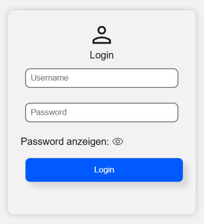
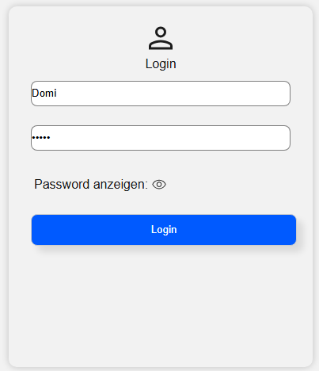
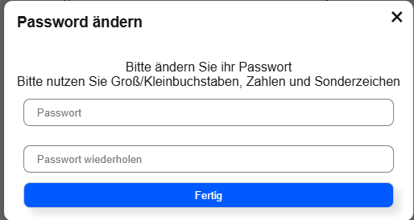
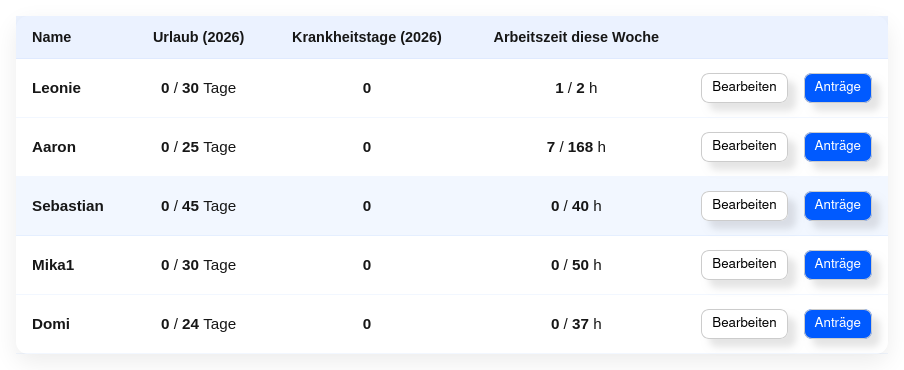
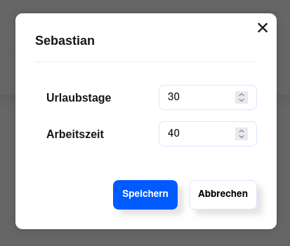
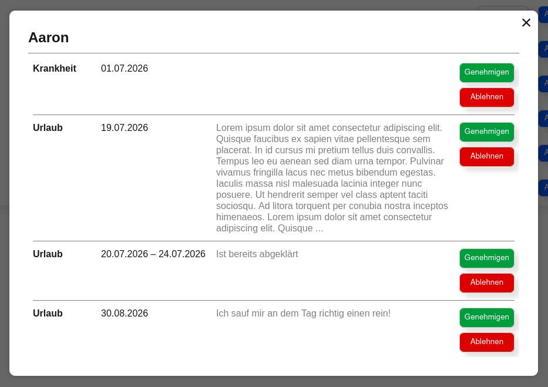
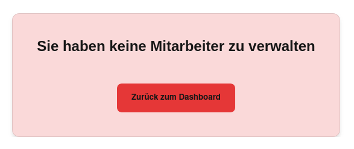

# How2CenterADiv Stechuhr
## Matrikelnummern:
    - justusbruegmann: 4865545
    - SebastianAnhalt: 7020807
    - mika630: 1586623
    - FHG : nummer Einfügen Bitte beachten Github Email und git Email unterschiedlich da Firmen Laptop
    - brdly06: Nummer einfügen
AI als Formulierungshilfe verwendet
# Was macht die Anwendung? (Mika)
# Struktur des Repo (Sebastian)


# Aufgabenverteilung

Der überwältigende Teil der DevOps wurde von `justusbruegmann` erledigt. Das umfasst die Erstellung und Pflege des Git-Repositories (inkl. der Code-Reviews zu PRs), die Einrichtung der PostgreSQL-Datenbank auf Supabase, sowie die Deployment-Prozesse auf zuerst Vercel und später Railway.

Die Datenbank-Schemata wurden von `justusbruegmann` und `Sebastian Anhalt` erstellt und gepflegt.

Die Zusammenführung und Integration der Frontend-Komponenten auf der /dashboard Seite sowie die Pflege der Kompatibilität zwischen den einzelnen Komponenten wurde maßgeblich von `Sebastian Anhalt` erledigt.

Zur Schaffung einer grundlegend einheitlichen Ästhetik in der Anwendunge wurden von `Sebastian Anhalt` und `justusbruegmann` zu Beginn der Entwicklung Layout-Komponenten erstellt, 
die im [Layout-Ordner](#srccomponents) zu finden sind und in vielen der Komponenten verwendet werden.

Die Aufteilung der Domain-Logik und der Funktionen der Anwendung können im Detail den Kapiteln [Was macht die Anwendung?](#was-macht-die-anwendung-mika) und [Eigenleistung](#eigenleistung) entnommen werden. Hier nur eine grobe Darstellung:

**justusbruegmann**
- Authentication & Authorization
- Login
- Benutzerverwaltung

**Sebastian Anhalt**
- Übersicht Tag/Woche/Monat der geleisteten Arbeitszeiten
- Manager-Ansicht zur Bearbeitung von Arbeitszeiten, Urlaubszeiten und Krankheitstagen der untergebenen Mitarbeiter (inkl. einiger weniger Benutzerverwaltung-Endpunkten im Backend)

**mika630**
- Ein-/Ausstempelfunktion auf dem Dashboard
- Darstellung der aktuellen Arbeitszeit und des aktuellen Status (gestempelt / nicht gestempelt)
- Bereitstellung der */timeEntry/* Endpunkte im Backend, also der zentralen Ressource für die Zeiterfassung

**FHG**
- Übersicht über alle Arbeitszeiten eines Tages
- Manuelles Nachtragen von Arbeitszeiten
- Funktion zum Stellen von Anträgen wegen Urlaubs oder Krankheit

**brdly06**
- Kalender auf dem Dashboard mit visueller Aufbereitung von Arbeitszeiten, Wochenenden, Feiertagen und Urlaubszeiten
- Benachrichtigungen 


# Setup der Dev Umgebung (Justus)

> Wichtig:  
> node und npm sind vorrausgesetzt sowie ein postgresSQL DBconnectionlink  
> Es gibt das Ganze SQL DB Script als sql Datei im docs Verzeichnis


Zuerst das Projekt Klonen

``git clone https://github.com/justusbruegmann/stechuhr.git``

## Frontend

Für das Frontend

````cmd
    cd frontend
    npm install
````

Dann muss eine ".env.local" im frontend Ordner ein mit
``NEXT_PUBLIC_BACKEND_URL=<BACKENDURL EINSETZEN>
`` vorhandensein.  
Mögliche werte:
- Lokales backend:   http://localhost:3500
- Hosted backend:   https://stechuhr-production-2a78.up.railway.app

Zum Starten ``npm run dev``


### Backend

Für das Backend

````cmd
    cd backend
    npm install
````

Dann muss eine ".env" im Backend Ordner ein mit
``DATABASE_URL=<DATENBANK_URL EINSETZEN>
`` vorhandensein.

Datenbank_URL wird noch bereit gestellt

zum Starten ``npm run dev``
nach jeder Änderung muss der command neu ausgeführt werden (kein HMR) und gewartet werden bis ``✓ Database connection successful
`` in der Console auftaucht dann ist das Backend bereit. 


# Starten der Anwendung (Justus)

> Wichtig:  
> node und npm sind vorrausgesetzt sowie ein postgresSQL DBconnectionlink  
> Es gibt das Ganze SQL DB Script als sql Datei im docs Verzeichnis

Zuerst das Projekt Klonen

``git clone https://github.com/justusbruegmann/stechuhr.git``

### Bauen
Zum Bauen muss das ``build.ps1`` script ausgeführt werden oder eins der Scripte ausgeführt werden aus dem root directory:

Beim build muss eine ".env.local" im frontend Ordner ein mit
``NEXT_PUBLIC_BACKEND_URL=<BACKENDURL EINSETZEN>
`` vorhandensein.  
Mögliche werte:
- Lokales backend:   http://localhost:3500
- Hosted backend:   https://stechuhr-production-2a78.up.railway.app


Cross-Plattform pwsh:  
``./build.ps1``

Windows:  
``.\build.bat``

Linux:  
``bash build.sh``

Zum Starten muss eine ".env" im Backend Ordner ein mit
``DATABASE_URL=<DATENBANK_URL EINSETZEN>
`` vorhandensein.

Datenbank_URL wird noch bereit gestellt

### Starten
Backend und Frontend laufen als getrennte Prozesse und werden jeweils in einem eigenen Terminal gestartet:

Backend (Terminal 1):
```cmd
   cd backend
   npm start
   ```   
   
  Warten bis ✓ Database connection successful in der Console erscheint, dann ist das Backend bereit.

  Frontend (Terminal 2):

      cd frontend
      npm start

  Die Anwendung ist danach unter http://localhost:3000 erreichbar.


# Webdesign (Aaron & Felix)


# Was macht die Anwendung
Die Anwendung dient zur Erfassung von Arbeitszeiten von Nutzern. Zudem erhält man einen Überblick über seine Zeiteinträge und kann diese jederzeit einsehen. Es gibt drei verschiedene Rollen von Anwendern:

## Rollen
### User
Als User ist es möglich sich über die Timecard ein- und auszustechen. Man erhält eine Überischt über die heute gearbeiteten Stunden, und über sein Saldo für den Tag, Woche und Monat. Im Kalender kann man außerdem auf einen Blick seine Zeitereignisse sehen. 
Zudem ist es möglich Abwesenheitsanträge in Form von Urlaub oder Krankheit zu erstellen. Auch vergessene Ein- und Ausstechzeiten kann man nachtragen.

### Manager
Als Manager hat man die selben Funktionen wie ein normaler User. Jedoch verfügt der Manager noch über die Manager-Ansicht über die er einen Überblick über seine zuständigen Mitarbeiter bekommt. Hier kann er deren Anträge genehmigen und wenn nötig auch Urlaubstage, Krankheitstage und Zeitereignisse anpassen.

### Admin
Als Admin ist es nicht möglich sich einzustechen, bzw. Zeiteinträge, Abwesenheitsanträge etc. zu erstellen. Die Admin Rolle dient nur zur Verwaltung der Benutzer der Anwendung. Es ist möglich neue Nutzer anzulegen, zu löschen und auch vorgeschriebene Arbeitszeiten und Urlaubstage anzupassen.

## Login
| Bild | Beschreibung |
|------|--------------|
|  | Die Login-Seite dient zur Anmeldung des Benutzers. Es gibt zwei Textfelder. In das obere Feld wird der Benutzername eingegeben, in das untere das Passwort. Nach erfolgreicher Eingabe gelangt der Benutzer über den Button "Login“ auf sein Dashboard. |

## Timecard
| Bild | Beschreibung |
|------|--------------|
|  | Über die Timecard ist es möglich sich ein- und auszustechen. Dies erfolgt über den grünen/roten Button. Nachdem man auf einstempeln bzw. auf ausstempeln geklickt hat wird der Button für einen Moment deaktiviert und zeigt einen spinner an. Dies liegt daran das der Button seinen Zustand erst ändert, wenn die Änderungen bereits erfolgreich in die Datenbank übernommen wurden. Die Timecard zeigt zudem auch die aktuelle Uhrzeit, ob man bereits ein- oder ausgestemeplt ist und wie lange man an dem aktuellen Tag schon gearbeitet hat. Ganz unten gibt es einen Button "xy" welcher auf das xy verweißt. |

## xy

# Struktur des Repositories
Das Repository ist als Monorepo in zwei Hauptteilen aufgebaut: Backend und Frontend. Zusätzlich liegt die Dokumentation des gesamten Monorepos im Ordner /docs.

Frontend und Backend sind eigenständige und voneinander losgelöste npm packages.

## Frontend
Das Frontend ist ein Next.js-Projekt, das auf der Vorlesungsvorlage mit React und TypeScript basiert.

Dementsprechend beinhaltet der Root Ordner 
- Konfigurationsdateien wie *.env*, *.gitignore*, *package.json*, etc.
- Build-Skripte für die Erstellung der Produktionsversion der Anwendung: *build.bat*, *build.ps1*, *build.sh*
- Assets in **/public** 
- den Quellcode-Ordner **/src**

Der Quellcode der Anwendung ist in folgenden Ordnern strukturiert:

### /src/app
Die Web-Anwendung verwendet den AppRouter, deshalb entspricht die Ordnerstruktur in /src/app den URL-Pfaden der Webseite.

Im Allgemeinen hat jede Route zwingend eine page.tsx-Datei, deren Inhalt unter dieser URL gerendert und angezeigt wird.
Außerdem können hier weitere Dateien wie z.B. CSS-Stylesheets (seitenname.module.css) oder lokal verwendete Components abgelegt sein.

#### Routen
**/** \
Enthält eine page.tsx, die nur eine Umleitung auf **/dashboard** auslöst.
Zusätzlich dazu liegen hier auch allgemeine Konfigurationen der Webseite:
- Das Favicon
- Ein Stylesheet, das globale Variablen definiert
- layout.tsx, welches den äußeren HTML-Rahmen der Seite definiert und benötigte Kontexte (hier nur ModalProvider) einbindet
- Eine not-found Seite, die als catch-all auf alle nicht definierten Routen reagiert

**/dashboard** `(hauptsächlich) Sebastian Anhalt` \
Das Dashboard ist die Hauptseite der Anwendung.
Sie enthält die Einstempelfunktion und einen Kalender.

**/login** `justusbruegmann` \
Die Login-Seite.

**/admin_view** `justusbruegmann` \
Eine Seite zur Benutzerverwaltung, auf die nur Admin-Accounts Zugriff haben.
Hier können neue Benutzer angelegt, bestehende Benutzer gelöscht, und ihre Rollen und die Zuordnung zu Vorgesetzten (Managern) verändert werden.

**/manager_view** `Sebastian Anhalt` \
Diese Seite wird nur für Manager-Accounts mit Inhalt befüllt, alle anderen sehen eine Fehlermeldung.
Hierauf können Manager die Arbeitszeiten, Urlaubstage ihrer Mitarbeiter einsehen und bearbeiten, sowie eine Zusammenfassung der geleisteten Wochenarbeitszeit, genehmigter Urlaubstage und eingetragener Krankheitstage sehen.
Außerdem können offene Anträge hier anzeigen lassen und akzeptieren / ablehnen.


### /src/components
Hier befinden sich die React-Components, die von den page.tsx in /src/app eingebunden werden, geordnet nach Anwendungsgebiet.

**Layout** \
Diese Komponenten sind als Erstes und in absichtlicher Allgemeinheit entstanden und mussten sich im Lauf der Entwicklung der Restlichen Anwendung verschiedenen Anforderungen anpassen. 
Sie sind unser Ersatz für ein UI-Framework, da wir keines verwenden durften, und erinnern daher durchaus bekannten Strukturen (z.B. Card).
Popup, Loader und Sidepane sind die drei Ausprägungen von Modals, die wir in der Anwendung verwenden. Sie basieren auf dem ModalContext (src/context/ModalContext). \
*Button + Header:* `justusbruegmann` \
*Card, Loader, Popup, Sidepane, SpinningLoader, Tabs:* `Sebastian Anhalt`

**Calendar** `brdly06` \
Diese Component erstellt den Kalender auf der /dashboard Seite. 

**Login** `justusbruegmann` \
Enthält nur eine Komponente: Ein Popup zum Ändern des One-Time-Passwords, das der Admin bei der Erstellung eines neuen Accounts vergibt.

**ManagerView** `Sebastian Anhalt` \
Enthält die Komponenten, die auf der /manager_view Seite verwendet werden: ein Popup zum Bearbeiten der vertraglichen Arbeitszeiten sowie Urlaubszeiten eines Benutzers, und die Tabellen zur Darstellung der Arbeitszeiten, Urlaubszeiten und Krankheitstage mehrerer User-Accounts.

**Overview** `Sebastian Anhalt` \
Enthält die Komponenten, die auf dem Dashboard eine Zusammenfassung der geleisteten Arbeitszeit und des Tages-, Wochen- und Monatsfortschritts darstellen.

**TimeAdjustment** `FHG` \
Die DailyDetailsPane zeigt alle eingetragenen Arbeitszeiten eines Tages an und ist öffenbar, indem man auf einen Tag im Kalender klickt.
Über den 'Manuell-Nachtragen'-Button öffnet sich ein Popup, in welchem die beiden anderen Komponenten dieses Ordners Verwendung finden.

**Timecard** `mika630` \
Die Timecard-Komponente ist die Einstempelfunktion auf dem Dashboard. Sie zeigt u.a. die aktuelle Uhrzeit, die aktuelle Arbeitszeit und den aktuellen Status (gestempelt / nicht gestempelt) an.

**Usermanagement** `justusbruegmann` \
Enthält die Komponenten, die auf der /admin_view Seite zur Darstellung und Verwaltung aller User Accounts verwendet werden.


### /src/context
Die Anwendung verwendet nur einen einzelnen Provider, den ModalContext, zur Bereitstellung der Funktion, von jeder Komponente aus ein möglicherweise geschachteltes Modal öffnen zu können.
Seit der Erweiterung, mehrere Modals gleichzeitig öffnen zu können und den Inhalt bereits geöffneter Modals neu zu rendern ist dieser Context unter starker Zuhilfenahme von KI entstanden.

### /src/scripts
Die Scripts in diesem Ordner umfassen die fetch-Funktionen, die von den React-Components aufgerufen werden, um mit dem Backend zu kommunizieren; gruppiert nach dem Endpunkt, den sie aufrufen.

### /src/types
Typ-Definitionen, die im Frontend zur starken Typisierung des Codes verwendet werden.

### /src/utils
Hilfsfunktionen, die an mehreren Stellen im Frontend verwendet werden, oder die zu umfangreich für die einzelnen page.tsx sind und daher ausgelagert wurden.


## Backend
Das Backend ist als Express-Server in TypeScript realisiert.

Die Design-Philosophie des Backends ist ein Drei-Schichten-Modell, bestehend aus 
1. HTTP-Layer in **./route**
2. Domainlogik-Layer in **./service**
3. Datenbank-Layer in **./repository**

### HTTP Layer
Hier werden die router-Objekte mitsamt Routen und Handler-Funktionen definiert.
Authentifizierung wird hauptsächlich durch eingebundene Middleware aus dem Ordner **/middleware** umgesetzt.
Autorisierung und Input-Validierung werden in den Handler-Funktionen geprüft.
Nach erfolgreicher Prüfung wird die Domain-Logik aufgerufen.

### Domainlogik-Layer
Die Logik und eigentliche Backend-Funktionalität der Anwendung wird in den Services (**/service**) implementiert.
Diese rufen die Repository-Funktionen auf, um mit der PostgreSQL-Datenbank auf Supabase zu kommunizieren.

### Datenbank-Layer
Die Datenbank-Konnektoren in /repository sind dünne Wrapper-Funktionen, die je eine einzelne SQL-Anfrage an die Datenbank beinhalten.
Sie kennen keine Logik oder Validierung und sind ausschließlich für die strukturierte und einfach wartbare Kommunikation mit der Datenbank zuständig.

### Sonstiges

**/** \
Die Project Root beinhaltet die üblichen Konfigurationsdateien wie *.env*, *.gitignore*, *Dockerfile*, *package.json*, etc., sowie den Einstiegspunkt *app.ts* der Anwendung.

**/drizzle** \
Der Drizzle-Ordner beinhaltet nur das ORM-Schema, auf dem die Datenbankverbindung der repository-Funktionen basiert.

**/middleware** \
In diesem Ordner sind die Middleware-Funktionen abgelegt, die von mehreren Routen verwendet werden.

**/schemas** \
Hier sind Zod-Schemas zur Input-Validierung definiert.

**/types** \
Geteilte TypeScript types und interfaces sind hier abgelegt.

**/utils** \
Hier befinden sich geteilte Hilfsfunktionen, die an verschiedenen Stellen in der Anwendung Verwendung finden.
Sie sind grob nach Anwendungsgebiet gruppiert.


# Eigenleistung

In diesem Kapitel werden diejenigen Ende-zu-Ende-Features der Anwendung beschrieben, die für das jeweilige Gruppenmitglied bewertet werden sollen.

## justusbruegmann: Auth
KI als Formulierungshilfe verwendet
### Ideen
Aufgrund von Kommunikation aus dem ersten Semester, dass nur das absolute Minimum an Fremdpakete verwendet werden soll, wurde angenommen das auch Login usw selbst gebaut werden müssen.
Deshalb wurde bereits vor der Kommunikation, dass solche Pakete erlaubt sind, das Feature schon fertiggestellt.

Es wurde sich aktiv gegen JWTs entschieden, da dort der Zugang nicht schnell entfernt werden kann.
Ebenfalls soll ein Admin als Verwalter Accounts erstellen da kein Mitarbeiter sein Account selbst anlegen soll.
Im Fall einer Kündigung oder ähnliches kann der Admin sehr schnell Zugang zur Zeiterfassung entfernen, damit kein Unsinn getrieben wird.

Es gibt 3 Rollen in der Anwendung:
- User: Ein ganz normaler Mitarbeiter
- Manager: Ein Vorgesetzter von einem Nutzer welcher Urlaubsanträge oder ähnliches bearbeiten kann sowie Arbeitszeiten seiner Untergebenen sehen kann. User + Zusatzrechte
- Admin: Reiner Verwaltungsaccount, kann keine timeEntries erstellen.

### Gesamtprojekt
Als Erstes landet der Nutzer auf der Login-Page und muss sich dort einloggen.  
Wenn er ein One-Time-Password hat dann muss dieses geändert werden.
Wenn kein One-Time-Password gesetzt ist und die Login-Daten valide sind, wird dieser zum Dashboard weitergeleitet
  
Die Auth läuft im Hintergrund beim Öffnen einer Page um zu überprüfen ob der Token noch valide ist oder überhaupt einer existiert.
  
Ebenfalls wird für die anderen Routen eine Middleware bereitgestellt, ob die mitgegebenen Authorization und Userid Header zu einem User gehören.
Dies ist dabei für fast jede Route relevant, da nur Nutzer welche zur Anwendung gehören diese Aktionen ausführen sollen.
```typescript
const ROLESPERMS: Record<UserRole,number> = {user: 1, manager: 2 , admin:3};

export function authMiddleware(requiredRole: UserRole, rolesAboveAllowed: boolean = false) {
    return async (req: Request, res: Response, next: NextFunction) => {
        try {
            const token = req.headers.authorization;
            const id = Number(req.headers.userid);
            if (!token || !id) {
                return res.status(401).json({"error": "No token provided"});
            }
            const authUser = await authHelper(token, id);
            if (!authUser?.authorized || !authUser.data.id || !authUser.data.role) {
                return res.status(401).json({"error": "unauthorized"});
            }
            if (rolesAboveAllowed) {
                const authUserLevel = ROLESPERMS[authUser.data.role as UserRole];
                const requiredLevel = ROLESPERMS[requiredRole];
                if (authUserLevel < requiredLevel) return res.status(403).json({error: "unauthorized"});
            } else {
                if (authUser.data.role !== requiredRole) return res.status(403).json({error: "unauthorized"});
            }
            res.locals.user = {id: authUser.data.id, role: authUser.data.role};
            next();
        } catch (e) {
            return res.status(500).json({"error": "internal error"});
        }
    }
}
```
rolesAboveAllowed sagt aus, ob eine Route, welche ein User zugreifen darf, auch ein Manager oder Admin zugreifen darf.


### Code

Backend Code ist im Ordner "backend" zu finden.  
Dabei gibt es in /route,/service,/repository die Datein Auth.ts und der OTPchange liegt in Usermanagement.ts  
Dazu sind in /utils hashing.ts und auth.ts  
Ebenfalls gibt es in /middleware die authmiddleware().

Frontend code ist im Ordner "frontend" zu finden.  
Für das Loginform sind in src/app/login die relevante css und page.tsx zu finden.  
Für die Passwortänderung das Popup ist in src/components/login die PasswordChangeModal.tsx zu finden

Alle drei fetch calls die für die Auth verantwortlich ist sind in src/scripts/auth.ts zu finden.

Es gibt auch noch die authCheck() Methode das Prinzip von der wird öfters im Frontend von allen verwendet.  
Diese hier ist spziell in src/app/dashboard/page.tsx zufinden
````typescript
async function authCheck() {
    const token = localStorage.getItem("token")
    const userid = localStorage.getItem("userid")

    if (!token || !userid) {
        router.push("/login")
        return
    }

    const login = await loginToken(token, userid);

    if (!login || login === 401 || login === 485 || login === 400) {
        router.push("/login")
        return;
    }

    localStorage.setItem("role", login.role);
}
````
### Backend
Die Auth hat 3 Routen 
1. GET /auth/ nimmt den session token und checkt ob dieser valid ist für den User  
    input Header: authorization, userid
    output json:{"role","id"}   
    Statuscodes:  
        - 200: Token ist valid  
        - 401: unauthorized wenn token ungültig  
        - 404: wenn auth() return undefined  
        - 485: Custom code dafür wenn der User ein one-time-password gesetzt hat. damit das frontend nur eine zahl checken muss     
        - 500: Alg error  
    id ist die user ID, session ist der Session token, role ist die Rolle welche der Nutzer 
    in der Anwendung hat
2. POST /login/ nimmt im Body den Username und das Passwort wenn diese Valide sind wird   
    input body: {"username","password"}  
    output json: {"id","session","role"}  
    Statuscodes:  
        - 201: username password sind valid  
        - 400: no body  
        - 401: unauthorized wenn username and password ungültig  
        - 404: wenn auth() return undefined  
        - 485: Custom code dafür wenn der User ein one-time-password gesetzt hat. damit das frontend nur eine zahl checken muss     
        - 500: Alg error  
3. PATCH aufgrund von CORS aktuell PUT /users/otp/:id zum ändern des oneTimePassword das man vom Admin bekommt  
    input body: {"currentpwd","newpwd"}  
    input params: id  
    output text: "changed succesfully"  
    Statuscodes:  
        - 400: no body or types wrong, or password incorect scheme  
        - 401: currentpwd is wrong  
        - 200: Password changed succesfully need to login with new password
        - 500: internal server error

### Frontend

Das login-Form sieht so aus:  
wenn der Nutzer sich einloggt erscheint ein spinner auf dem Login Button.  
bei erfolgreichem Login wird der Nutzer zum dashboard weitergeleitet.  


  

Bei one Time Password wird ein Popup angezeigt.  
dabei muss der Nutzer sich ein neues Password vergeben welches nur er kennt.  
Wenn das Passwort verändert wurde kann der Nutzer sich normal anmelden.  



## Sebastian Anhalt: Manager-Ansicht

### Kontext
Es gibt drei Arten von Rollen in der Anwendung: User, Manager und Admin.
- User: Ein ganz normaler Mitarbeiter, einem Manager untergeordnet
- Manager: Ein Vorgesetzter, der die Arbeitszeiten, Urlaubszeiten und Krankheitstage seiner untergebenen Mitarbeiter einsehen und bearbeiten kann. Hat potenziell auch einen übergeordneten Manager.
- Admin: Ein reiner Verwaltungsaccount, der keine Arbeitszeiten eintragen kann, aber Benutzerkonten erstellen und löschen kann.

Die Manager-Ansicht ist daher der Teil der Anwendung, der für Manager-Accounts sichtbar ist und ihnen die Verwaltung ihrer untergebenen Mitarbeiter ermöglicht.

### Frontend

#### Funktion

Die Manager-Ansicht ist in der Anwendung unter der Route /manager_view erreichbar.
Sie besteht aus einer einzigen großen Tabelle, die für jeden dem angemeldeten Manager untergebenen Mitarbeiter seine vertraglich vereinbarten und bereits genommenen Urlaubstage, seine festgeschriebenen Krankheitstage und eine Zusammenfassung über die geschuldete und bereits geleistete Wochenarbeitszeit anzeigt.
Außerdem können über den Button "Bearbeiten" in einem Popup die Wochenarbeitszeit und die Urlaubstage angepasst werden.
Zuletzt kann der Manager hier über den Button "Anträge" in einem Popup offene Anträge seiner untergebenen Mitarbeiter einsehen und akzeptieren oder ablehnen.







Zum Styling des Frontends ([Manager View](/frontend/src/app/manager_view/manager_view.module.css), [User Table](/frontend/src/components/managerView/userTable.module.css), [EditUserModal](/frontend/src/components/managerView/editUserModal.module.css)) wurde in Teilen KI verwendet.
Eine genaue Kennzeichnung ist hier schier unmöglich, da die KI einen bestehenden Grundstock an CSS erweitert hat, der dann manuell noch an vielen Stellen nachgebessert wurde.


#### Sicherheit
Die Webseite nutzt kein SSR. Deshalb ist es kaum möglich, die Route /manager_view Nicht-Manager-Accounts unzugänglich zu machen.
Der Zugriff darauf ist ausschließlich dadurch etwas erschwert, dass nur Manager den Button im Header angezeigt bekommen, der auf diese Seite führt.

Die eigenltiche Sicherheit wird durch das Backend gewährleistet. Bei der Anfrage nach Benutzern, deren Manager der angemeldete Benutzer ist, wird dementsprechend unberechtigten Accounts eine leere Liste zurückgeliefert.
Sie sehen dann grafisch dieselbe Fehlermeldung wie Manager-Accounts, die keine untergebenen Mitarbeiter haben:





#### Implementierung
Beim Laden der Seite ruft das Frontend die Liste der untergebenen Mitarbeiter des angemeldeten Managers ab.
Außerdem lädt es für jeden dieser Mitarbeiter je zwei Zusammenfassungen: eine über die aktuelle Woche und eine über den aktuellen Monat.
Zusätzlich wird zu jedem Mitarbeiter die Liste der offenen Anträge geladen.

Solange auf die Antworten des Backends gewartet wird, zeigt das Frontend einen Ladebildschirm an.
Dies kann durch die Menge an gleichzeitigen Anfragen trotz der eingebauten Parallelisierung eine ganze Weile dauern. Für eine produktionsreife Anwendung könnte man hier über Optimierungen nachdenken, z.B.:
- spezifischere Endpunkte im Backend gestalten, die die Wochenarbeitszeit und Monatlichen Urlaubstage in einem einzigen Request zurückliefern
- durch Caching wenigstens beim wiederholten Besuch der Manager-Ansicht die Anfragen an das Backend reduzieren
- Teile der Seite schon rendern (Tabelle), während noch z.B. Zusammenfassungen geladen werden
- präventiv die Daten der Manager-Ansicht preloaden, während der Benutzer noch auf dem Dashboard ist


> Aus Designgründen gefällt mir der API-Endpunkt für dieses Projekt in seiner derzeitigen Form besser, als eine durch Domain-Logik spezialisierte Form.
Der Rest der Ideen sprengt den Rahmen dessen, was ich an Zeit und Aufwand bereit bin, noch in das Projekt zu investieren. Bitte habt ein paar Sekunden Geduld beim Laden der Seite.

Aus den Antworten wird ein erweitertes User-Objekt zusammengesetzt, in dem die relevanten Daten für jeden Mitarbeiter zusammengefasst sind:
```typescript
type UserWithSummaryEntries = User & {
    summaryEntries: {
        vacationDaysThisYear: number | null;
        sickDaysThisYear: number | null;
        hoursWorkedThisWeek: number | null;
    };
};
```
Es folgen Definitionen für die handler-Funktionen zum Bearbeiten von Mitarbeiterdaten und zum Akzeptieren/Ablehnen von Anträgen.

Schließlich werden die Daten als fertige React.ReactNode-Elemente an die UserTable-Komponente übergeben, die sie in einer Tabelle darstellt.

Die Bearbeitungsfunktionen öffnen jeweils ein Popup: das EditUserModal zum Bearbeiten von Arbeitszeiten und Urlaubstagen, und das RequestsModal zum Anzeigen und Bearbeiten von Anträgen.
Die Definitionen dieser Modals sind in /src/components/managerView zu finden.

Beide funktionieren ähnlich: sie erhalten den initialen Stand der Daten, die sie darstellen sollen und eine Callback-Funktion, die den lokalen Zustand aktuell halten, ohne nach jeder Änderung eine erneute Server-Anfrage triggern zu müssen.
Trotzdem haben beide jeweils eine Besonderheit:

**EditUserModal:** \
Das EditUserModal fordert nur die userId als notwendigen Parameter. Wird kein fertiges user-Objekt übergeben, lädt es die Daten des Benutzers selbstständig nach, um sie im Modal darstellen zu können. Falls der User aber schon im Vorfeld geladen wurde, kann er als user-Objekt übergeben werden, um die erneute Anfrage zu vermeiden.
Da die Manager-Ansicht der einzige Punkt der Anwendung ist, an dem das Modal eingebunden ist, bleibt diese Funktion momentan unbenutzt. Da es aber nun schon einmal existiert und ich die Möglichkeit nicht ausschließen konnte, dass sie in der weiteren Entwicklung der Anwendung noch hätte Verwendung finden können, habe ich sie nicht entfernt.

**RequestsModal:** \
Das RequestsModal muss mit einer schrumpfenden Liste von Anträgen umgehen können, da beantwortete Anträge aus der Ansicht entfernt werden.
Deshalb existiert hier ein useEffect-Hook, der bei jeder Änderung des lokalen Stands der Anträge des geöffneten Users den Inhalt des Modals neu rendert.

### Backend
Gemäß dem generellen Aufbau des Backends besteht jeder Endpunkt aus drei Schichten: 
- **/route**: Hier wird die Route definiert, Middleware eingebunden und Authorization und Input-Validierung durchgeführt.
- **/service**: Hier wird die eigentliche Domainlogik implementiert.
- **/repository**: Hier werden die SQL-Abfragen an die Datenbank definiert.


Die Manager-Ansicht benötigt drei Endpunkte im Backend, um die benötigten Daten zu laden und zu bearbeiten:

#### GET /users/manager/users
[Link zum Code](/backend/route/userManagement.ts#L137) \
Hier werden alle Benutzer zurückgeliefert, deren Manager der angemeldete Benutzer ist.\
Es ist quasi keine Authorization zu erledigen, da bei dieser Anfrage keine parameter außer der bereits verifizierten Identität des Antragstellers verwendet werden. \
Daher werden Anfrage und Antwort mit minimalem Aufwand durchgereicht: \
route → service → repository → service → route. 

#### PATCH /users/:id/employment
[Link zum Code](/backend/route/userManagement.ts#L167) \
Hierüber kann der Manager die Wochenarbeitszeit und die Urlaubstage eines untergebenen Mitarbeiters bearbeiten. \
Dieser Endpunkt hat eine etwas komplexere Authorization. Zuerst wird der mitgelieferte Payload mittels eines Zod-Schemas validiert.
Dann folgt die Überprüfung, ob der angemeldete Benutzer der Manager des zu bearbeitenden Mitarbeiters ist.
Sofern eine gültige Anfrage vorliegt, wird sie an den Service weitergeleitet, der die Datenbank aktualisiert.

#### GET /summary?userId=:id&startDate=:startDate&endDate=:endDate
[Link zum Code](/backend/route/summary.ts) \
Der Summary-Endpunkt stellt eine nicht-persistente Ressource zur Verfügung, die eine Zusammenfassung der Arbeitszeiten, Urlaubstage und Krankheitstage eines Benutzers für einen bestimmten Zeitraum liefert.
Er hat dementsprechend keine Funktion in **/repository** und wird ausschließlich durch den Aufruf anderer **/service**-Funktionen mit Leben gefüllt.

In **/route** werden die Parameter mithilfe eines Zod-Schemas und weiterer Funktionen validiert. Danach wird noch mehr Authorization durchgeführt,
indem überprüft wird, ob der angemeldete Benutzer entweder der Benutzer selbst oder dessen Manager ist.

In **/service** werden drei Anfragen an den TimeEntriesService von *mika630* durchgeführt, um Listen zu eingetragenen 
Arbeitszeiten, Urlaubstagen und Krankheitstagen des Benutzers im gegebenen Zeitraum zu laden. Aus diesen Daten wird dann die Zusammenfassung erstellt in Form des folgenden DTOs zurückgegeben:

```typescript
/**
 * Strings to represent a date in the format YYYY-MM-DD
 */
export type DateString = string;

export default interface Summary {
    userId: number;
    startDate: DateString;
    endDate: DateString;

    vacationDaysTaken: number;
    sickDaysTaken: number;
    timeWorkedInMinutes: number;
}
```

### Honorable Mention: Overview auf Dashboard
Die Übersicht auf dem Dashboard war anfangs als meine zu bewertende Eigenleistung geplant. 
Da sie allerdings komplett ohne zusätzliches Backend auskommt und ihren Zustand nur aus der ohnehin im Frontend vorhandenen 
Liste aller Zeiteinträge des aktuellen Monats generiert werden kann, erfüllt sie den Anspruch als End-to-End-Feature nicht.

Trotzdem bin ich stolz auf das Endprodukt, in dem jedes einzelne Element von mir stammt (inkl. Sidepane mit Animation, Tabs-Feature, DetailEntry mit Animation, und die mühselige Zeitberechnung in timeUtils.ts).


## mika630: Timecard

## brdly06: Notifications

## FHG: Requests